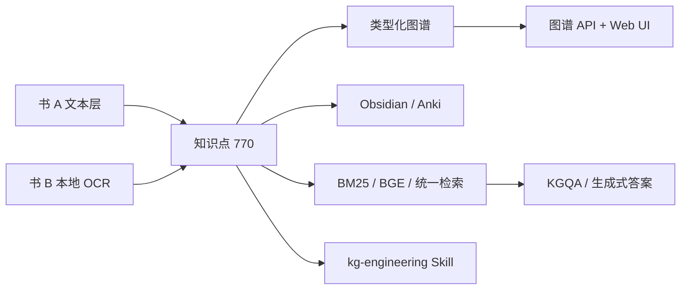

# 知识图谱两书蒸馏

把《知识图谱导论》与《知识图谱与深度学习》整理成**可检索、可运行、可评测**的知识库：770 个知识点、442 条图表索引、类型化图谱、检索/问答服务，以及一个可执行的 `kg-engineering` Skill。

这不是又一份书单，也不是抽取工具包。它展示的是：两本教材 → 结构化知识库 → 图谱与检索 → Agent Skill 的完整落地链路，包含构建脚本、审计、测试和回测数据。

## 包含什么

| 模块 | 规模 |
|---|---:|
| 知识点 | 770（书 A 419 / 书 B 351） |
| 章节 | 17 章 / 94 节 |
| 图表索引 | 442（图 342 / 表 100） |
| 表记录 | 100（37 矩阵 / 5 键值 / 58 索引） |
| 主图谱 | 1361 节点 / 3140 边 / 12 类关系 |
| 实例层 | 118 节点 / 176 边（64 方法 / 18 任务 / 26 数据集 / 10 指标） |
| 术语表 | 40 条中英术语，37 条已解析到知识点 |
| 导出 | Obsidian 双链库、Anki 卡组、Canvas、CSV/JSON/GraphML/TTL |

知识点按「概念 / 方法 / 模型 / 算法 / 系统 / 案例 / 对比 / 原则」分类；每条含转述定义、2–4 条要点、前置知识与页码定位。

## 架构



## 快速开始

零依赖检查（只需要 Python 3.10+）：

```bash
python -I run_all.py --check
```

启动图谱服务与 Web UI：

```bash
python -I knowledge-base/service/graph_service.py --port 8765
# 打开 http://127.0.0.1:8765/
```

检索知识库：

```bash
python -I knowledge-base/search/kg_search.py "TransE 负采样" --limit 8
python -I knowledge-base/search/kg_rag.py "TransE 怎么处理一对多关系？" --k 3
```

浏览 Obsidian 库：用 Obsidian 打开 `knowledge-base/obsidian/`，从 `00-索引/总索引.md` 进入。
导入 Anki：`knowledge-base/anki/kg-cards.csv`。

## 评测结果

全部为本仓库自带的 30 题小规模评测，脚本与数据在 `knowledge-base/eval/`、`outputs/kg-engineering/evals/`。

| 环节 | 指标 | 结果 |
|---|---|---:|
| 统一检索（k=15） | 命中率 / 支持覆盖率 | 0.900 / 0.719 |
| 抽取式答案（覆盖优先） | 关键词覆盖 / 引用精确率 / 召回率 | 0.756 / 0.439 / 0.660 |
| 生成式答案（DeepSeek，剪枝后） | 覆盖 / 精确率 / 召回率 | 0.717 / 0.589 / 0.522 |
| 引用句级 NLI | 严格过滤后支持率 | 100%（30 条引用） |
| Skill 决策盲测（4 模型 × 20 题） | 分支正确 / 概念覆盖 | 80/80 / 94.5% |

这些数字的边界写在对应报告里：评测集小、检索上下文精确率偏低、NLI 与生成使用同族模型、只覆盖教材知识点。不要外推到生产。

## 目录结构

```text
.
├── run_all.py                  # 一键重建 + 一致性检查
├── knowledge-base/
│   ├── data/                   # 按章组织的知识点源数据
│   ├── graph/                  # 类型化图谱、GraphML、TTL、查询示例
│   ├── instances/              # 方法/任务/数据集/指标实例层
│   ├── figures/                # 442 条图表索引
│   ├── tables/                 # 100 张表的结构化记录
│   ├── search/                 # BM25 / LSA / BGE / 统一检索 / RAG
│   ├── service/                # 零依赖图谱 API + Web UI + Docker
│   ├── obsidian/               # 双链笔记库
│   ├── anki/                   # 记忆卡
│   ├── glossary/               # 中英术语表
│   ├── llm/                    # 多厂商生成式答案 + 引用核验
│   ├── audit/                  # 公式/数字/覆盖率/最终一致性检查
│   └── tests/                  # 数据、图谱、图表、服务测试
├── outputs/kg-engineering/     # 可执行 Skill：SKILL.md + references + scripts + evals
├── tools/make_public.py        # 生成脱敏公开包
└── audit/public_release_check.py
```

## kg-engineering Skill

`outputs/kg-engineering/SKILL.md` 覆盖：能力问题、Schema/本体、表示与存储选型、知识抽取、融合对齐、推理补全、KGQA、图分析、语言知识图谱、评估验收。

适用：领域图谱从零规划、已有图谱改造、KG 项目技术选型与方案评审。
不适用：具体框架的 API 用法、需要跑通某个开源项目的安装教程。

## 数据来源与使用边界

- 内容是对两本教材的**转述与结构化整理**，不是原文，也不包含 PDF、逐字抽取文本或图表扫描页。
- 页码用于定位原书，公式与 OCR 细节可能有误差；关键结论请对照原书。
- 版权归原作者与出版方。本仓库用于学习、研究与技术讨论；公开再分发或商业使用前请自行确认授权。
- 详细边界见 [knowledge-base/NOTICE.md](knowledge-base/NOTICE.md)。

## 许可证

- **代码**（`*.py`、构建脚本、服务、测试）：MIT，见 [LICENSE](LICENSE)。
- **知识内容**（知识点、笔记、图表索引、图谱数据）：仅供学习研究，不随 MIT 授权；版权归原书作者。

## 复现

```bash
python -I run_all.py            # 从已提交的数据重建全部导出
python -I run_all.py --check    # 追加 30 项一致性检查
python -m unittest discover -s knowledge-base/tests
```

不依赖原书即可重建；原始 PDF 与抽取文本不随仓库分发。

版本：3.0.0
